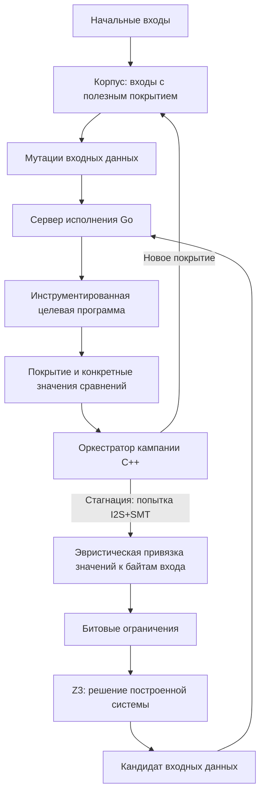

# MLFuzzZ3

Исследовательский гибридный фаззер, который сочетает мутацию входных данных
с эвристическим сопоставлением входа и значений сравнений (I2S) и решением
ограничений через SMT-солвер Z3.

Исследовательский вопрос: когда информация о сравнениях и SMT помогают
пройти ветви, плохо достижимые случайными мутациями, и когда затраты на
решатель не окупаются? Проект изучает как положительные результаты, так и
ограничения метода на реальных программах.

## Текущее состояние

Реализованы мутационный цикл, корпус входов, инструментация покрытия и
значений сравнений, сервер исполнения на Go и гибридный путь I2S+SMT.
Полного символьного исполнения, теневой памяти и taint-анализа нет.
Историческое название «concolic» в коде не означает наличие этих механизмов.

Продуктовый LLM-компонент, детерминированный планировщик потоков и собственный
sanitizer пока не реализованы. Текущая исследовательская фаза не закрыта.
Карта реализации и границ доказательства — [текущее состояние](docs/CURRENT_STATE.md).

## Как работает реализованный путь



Сервер запускает отдельный процесс цели для каждого входа. Инструментация
передаёт покрытие и операнды сравнений через разделяемую память; ядро
использует их для выбора следующих входов. Persistent mode остаётся будущей
работой.

SAT/UNSAT относится к построенной системе ограничений и не доказывает
корректность её привязки к исходной программе. Полученный кандидат
проверяется реальным исполнением. Новое покрытие само по себе не доказывает
инверсию выбранной точки сравнения.

## Документация и результаты

- [Задумка и назначение компонентов](PROJECT_VISION.md).
- [Архитектура](docs/ARCHITECTURE.md).
- [Что реализовано и какие выводы допустимы](docs/CURRENT_STATE.md).
- [Сборка и проверка](docs/DEVELOPMENT.md).
- [Методика, измерения и открытые вопросы](docs/EVALUATION.md).
- [Экспериментальные материалы](docs/experiments/).

Для интерпретации результата нужны сценарий, версия кода, конфигурация,
исходные данные и способ пересчёта. Подготовленная оснастка не считается
завершённым экспериментом, а отсутствие измерения не заменяется выводом.

## Сборка

Основной стек: C++20, CMake 3.25+, Go (см. `exec-server/go.mod`), Z3 и LLVM 20 для инструментации.
Подготовка окружения описана в [инструкции](docs/DEVELOPMENT.md).
После установки зависимостей:

```sh
git submodule update --init --recursive
CC=clang-20 CXX=clang++-20 cmake -B build -G Ninja -DCMAKE_BUILD_TYPE=Debug
cmake --build build -j4
ctest --test-dir build --output-on-failure
```

Go-компонент собирается и проверяется отдельно:

```sh
cd exec-server
go build ./...
go test ./...
```

Первое конфигурирование может загружать зависимости. Полный набор тестов
включает длительные интеграционные прогоны. Эти команды описывают текущий
путь сборки; статус проверки этого среза указан в [VALIDATION.md](docs/VALIDATION.md).

## Лицензия

Исходный код распространяется под [MIT](LICENSE). У внешних зависимостей,
целей и корпусов собственные лицензии.
